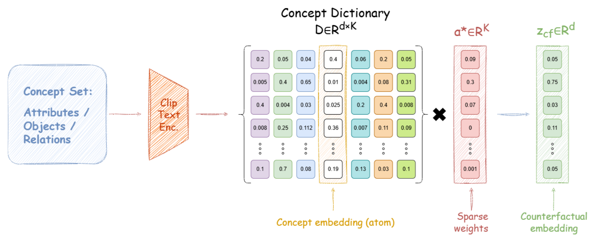
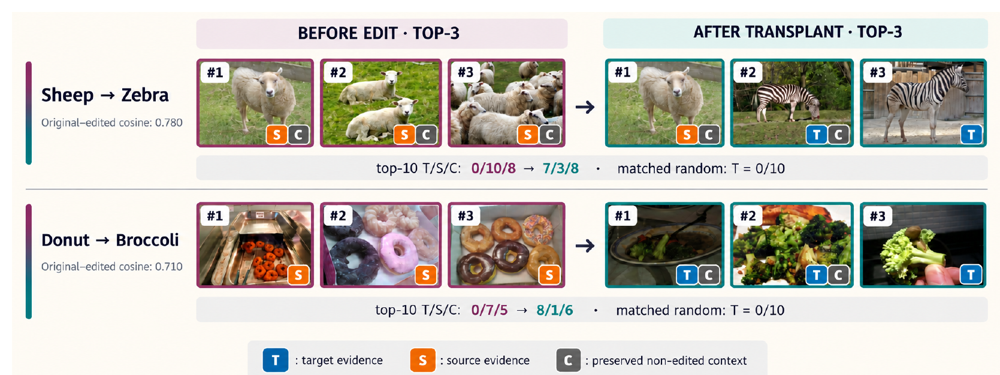

<div align="center">

# LACE

### Latent Alignment via Counterfactual Embeddings

**[Harsh Udai](mailto:ai23resch11003@iith.ac.in) · [Konda Reddy Mopuri](mailto:krmopuri@ai.iith.ac.in)**

Department of Artificial Intelligence, IIT Hyderabad

<br>


<br>

*Teaching CLIP-style models **which** attribute belongs to **which** object,<br>
with hard negatives built in embedding space, for both images and text.*

</div>

<br>

> [!NOTE]
> **Code release in progress.** This repository currently hosts the project overview. Dictionary construction, training, and evaluation code will be released here soon. Star or watch the repo to get notified.

<br>

## ✦ The problem

Vision–language models like CLIP know *what* is in an image, but often not *how it fits together*. They struggle to tell

> *"a **red** suitcase next to a **black** backpack"* &nbsp;from&nbsp; *"a **black** suitcase next to a **red** backpack"*

The usual fix is to add **text-side hard negatives**: swapped, negated, or perturbed captions. That puts all the fine-grained pressure on the text encoder. The image encoder never sees a comparable near-miss, so the shared embedding space becomes lopsided: more hubs, fewer reciprocal neighbors, and brittle behavior under small edits, even when retrieval scores look fine.

<br>

## ✦ The idea

LACE builds **counterfactual hard negatives for both modalities, directly in embedding space**. It uses no pixel editing, no diffusion models, and no retrieval mining.

<p align="center">
  
</p>

**① Decompose.** Each image or text embedding is written as a sparse mix of atoms from a fixed dictionary of *object*, *attribute*, and *relation* concepts.

**② Edit.** A few active concepts are attenuated, swapped, or transplanted with a same-type concept (e.g. *sheep → zebra*). The embedding is then rebuilt, giving a targeted near-miss that keeps the rest of the scene intact.

**③ Train symmetrically.** Edited text embeddings serve as negatives for image→text retrieval, and edited image embeddings serve as negatives for text→image retrieval. Both encoders learn to resolve the fine-grained difference.

At inference, LACE disappears: the model is a **standard dual encoder** with no dictionary, solver, or extra module.

<br>

## ✦ Edits that mean something

Transplanting a single concept in latent space moves an image's nearest neighbors to the target concept while preserving the surrounding context. A random edit of the same size does nothing of the sort.

<p align="center">
  
</p>

<br>

## ✦ Highlights

- 🧩 **Two-sided hard negatives** from a single latent editing operator, generated on the fly during training
- 🎯 **Stronger compositional reasoning** on COLA, What'sUp, Winoground, SugarCrepe / SugarCrepe++, and MMVP-VLM, with the largest gains in multi-object binding and fine-grained visual patterns
- 🕸️ **Healthier embedding geometry**: higher neighborhood reciprocity, lower hubness, and roughly **3× fewer brittle failures** under relation and attribute swaps than matched fine-tuning
- 🔁 **Works across objectives**: softmax InfoNCE (OpenCLIP ViT-B/32) and pairwise sigmoid (SigLIP ViT-B/16)
- ⚡ **Zero inference overhead**: changes training only

See the paper for full results, comparisons with prior compositional methods, and ablations.

<br>

## ✦ Roadmap

```
LACE/
├── configs/              OpenCLIP and SigLIP training configs
├── dictionary/           concept extraction, filtering, embedding
├── lace/
│   ├── sparse_coding.py  batched FISTA / LASSO solver
│   ├── counterfactual.py editable-set filtering, attenuate / swap / transplant
│   └── losses.py         symmetric InfoNCE and SigLIP counterfactual losses
├── train.py              LoRA fine-tuning with Accelerate
├── eval/                 compositional benchmarks, retrieval, zero-shot
└── geometry/             hubness, reciprocity, local-edit diagnostics
```

- [ ] Concept dictionary construction and released dictionaries
- [ ] Sparse coding and counterfactual generation
- [ ] OpenCLIP and SigLIP training code
- [ ] Evaluation suite: COLA, What'sUp, Winoground, SugarCrepe / SugarCrepe++, MMVP-VLM, retrieval, ImageNetV2
- [ ] Geometry diagnostics: hubness, reciprocity, local edit stability
- [ ] Trained LoRA checkpoints

<br>

## ✦ Citation

If LACE is useful in your work, please cite:

```bibtex
@inproceedings{udai2026lace,
  title     = {{LACE}: Latent Alignment via Counterfactual Embeddings},
  author    = {Udai, Harsh and Mopuri, Konda Reddy},
  booktitle = {Advances in Neural Information Processing Systems},
  year      = {2026}
}
```

<br>

## ✦ Acknowledgments

LACE builds on [OpenCLIP](https://github.com/mlfoundations/open_clip) and [SigLIP](https://arxiv.org/abs/2303.15343), and is evaluated on public compositionality benchmarks. We thank their authors for releasing code and data.

## ✦ License

Released under the [MIT License](LICENSE). Datasets, benchmarks, and pretrained checkpoints used with this code remain under their own licenses.

<br>

<div align="center">
<sub>Questions? Open an issue or write to <a href="mailto:ai23resch11003@iith.ac.in">ai23resch11003@iith.ac.in</a></sub>
</div>
